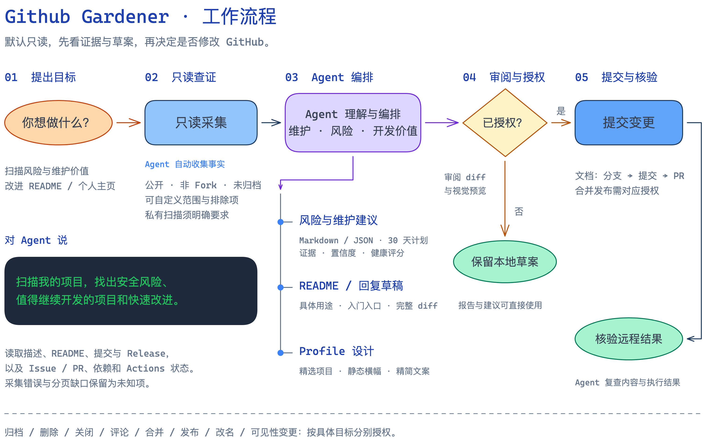

# Github Gardener

[简体中文](README.md) | English

An Agent Skill for tending your GitHub project garden.

Tell your Agent what you want to organize. It scans repositories, assesses risks and development potential, improves project descriptions, designs your profile, and prepares changes for review. The Agent handles installation, configuration, and execution.

## What it can do

- **Organize projects**: Identify projects worth developing, in need of maintenance, or ready for archival, with evidence and recommendations.
- **Find problems**: Check security alerts, failed CI, unanswered issues, pull requests awaiting review, and documentation gaps.
- **Promote projects**: Improve READMEs, descriptions, and topics so others can understand and use your projects more easily.
- **Design your profile**: Select featured projects and shape concise copy and visuals for a distinctive GitHub profile.
- **Plan maintenance**: Prepare quick improvements, draft replies, and a 30-day action plan.

Read-only by default. Changes come with diffs and previews for review; deletion, archival, comments, merges, publishing, and other actions each require separate confirmation. Custom scopes are supported, including private repository scans when explicitly requested.

## Ask your Agent to install it

Send this prompt to Codex or another Agent that supports Agent Skills:

```text
Install the Github Gardener Skill from https://github.com/yayapao/github-gardener for me, prepare its dependencies, and verify the installation.
```

## Once installed, just ask

```text
Scan my GitHub projects for security risks, projects worth developing further, and cleanup candidates. Start with recommendations.
```

```text
Improve the README and description for my-tool so community users can understand what it does more easily.
```

```text
Redesign my GitHub profile to highlight Agent development. Keep it concise and show me a preview first.
```

You can also invoke it with `$github-gardener`, or simply ask to “cut the copy by 50%” or “draft replies to these issues.”

## Workflow

The workflow diagram and supporting documentation below are in Chinese.



[Agent execution guide](docs/usage.md) · [Skill entry point](SKILL.md) · [Design notes](docs/design.md) · [Sharing assets](docs/share/README.md) · [Contributing](CONTRIBUTING.md)

[MIT](LICENSE) © yayapao
