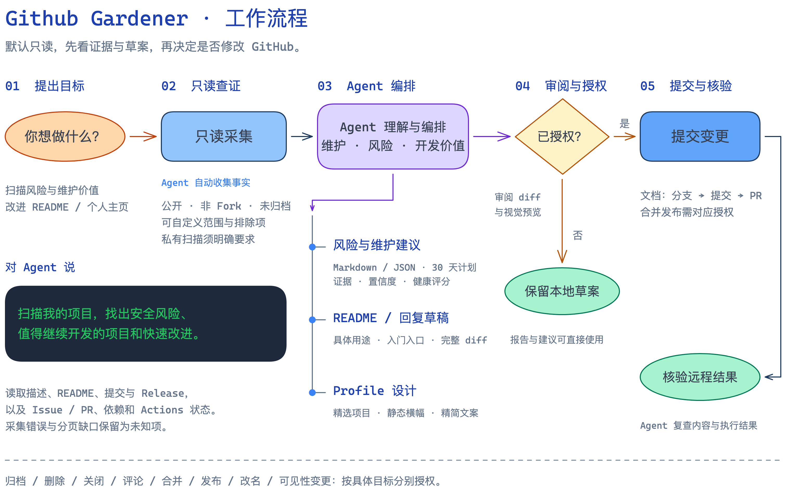

# Github Gardener

你的 GitHub 项目花园管家，一个交给 Agent 使用的 Skill。

告诉 Agent 你想整理什么：它会扫描仓库、分析风险与开发价值、改进项目介绍、设计个人主页，并准备可审阅的修改。安装、配置和具体操作都由 Agent 处理。

## 能做什么

- **整理项目**：找出值得继续开发、需要维护或适合归档的项目，给出证据与建议。
- **发现问题**：检查安全告警、失败 CI、长期未回复的 Issue、待审 PR 和文档缺口。
- **推广项目**：优化 README、描述与 Topics，让别人更容易理解和使用你的项目。
- **设计主页**：精选展示项目，编排简洁文案与视觉，让 GitHub Profile 更有辨识度。
- **安排维护**：整理快速改进、回复草稿和 30 天行动计划。

默认只读。修改前展示差异与预览；删除、归档、评论、合并、发布等操作分别确认。支持自定义范围和明确要求的私有仓库扫描。

## 让 Agent 安装

把下面这句话发给 Codex 或支持 Agent Skills 的 Agent：

```text
请从 https://github.com/yayapao/github-gardener 为我安装 Github Gardener Skill，并完成依赖准备和安装核验。
```

## 安装后，直接说

```text
扫描我的 GitHub 项目，找出安全风险、值得继续开发的项目和清理候选，先给建议。
```

```text
优化 my-tool 的 README 和描述，让社区用户更容易理解它的用途。
```

```text
帮我重新设计 GitHub 主页，重点展示 Agent 开发，保持简洁，先给预览。
```

也可以用 `$github-gardener` 指定调用，或直接说“文案减少 50%”“给这些 Issue 写回复草稿”。

## 工作流程



[Agent 执行指引](docs/usage.md) · [Skill 入口](SKILL.md) · [设计说明](docs/design.md) · [参与开发](CONTRIBUTING.md)

[MIT](LICENSE) © yayapao
