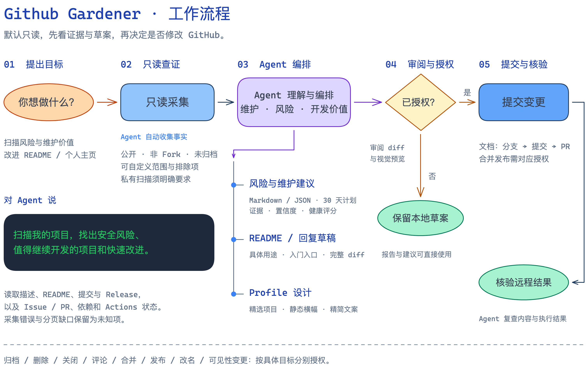

# 设计与能力边界

Github Gardener 是 Agent 可调用的 Skill。用户入口说明它是什么、能做什么，并提供安装 Prompt 与自然语言用法；安装、配置和操作步骤由 Agent 承接，具体指引见 [Agent 执行指引](usage.md)。脚本负责收集和计算可复核的事实，Agent 负责理解项目、取舍内容与形成建议；远程修改依赖当前会话中的明确授权。

## 工作流程

主流程体现调用顺序，分支展示维护报告、内容草稿和 Profile 设计三类产出。未授权时交付本地结果；文档修改按授权创建分支和 PR，合并发布与仓库操作分别授权。

[可编辑 Excalidraw 源文件](assets/gardener-workflow.excalidraw)，与 README 复用同一张导出图片。

## 分工

| 层 | 入口 | 职责与产物 |
| --- | --- | --- |
| 调用 | `SKILL.md`、`agents/openai.yaml` | 判断何时使用，按任务读取对应参考指南 |
| 采集 | `gardener_common.py`、`gardener_collect.py` | 通过 gh REST/GraphQL 分页读取，记录错误与覆盖率，裁剪敏感字段 |
| 分析 | `gardener_analysis.py` | 分别判断维护状态、健康风险和发展价值，不以提交时间直接决定归档 |
| 报告 | `gardener_report.py` | Markdown、JSON、维护计划及 Profile 事实草案 |
| 编辑 | Agent + `references/` | 阅读真实文件，写 README、回复草稿，设计和编排个人主页 |
| 变更准备 | `prepare_change.py` | 本地完整 diff 与 SHA-256 校验；已有仓库真实 SHA 或新 Profile 空基准 |
| 安装与分发 | `skill_files.py`、`install_skill.py`、`package_skill.py` | 同一文件清单用于安装和 ZIP；升级保留可恢复备份 |

扫描脚本不执行写 API。Agent 只有在获得对应动作的授权后，才使用 gh 创建分支、提交、开 PR 或进行其他操作；配置、评分、候选标记和哈希都不是授权。

## 三种判断保持独立

- **维护状态**：多维活动与用户维护意图。安静的成熟项目仍可能稳定维护。
- **健康风险**：安全告警、CI、响应积压和文档缺口。高分不代表完成全面安全审计。
- **发展价值**：需求、差异化、可实现性和用户投入意愿。证据不足时设计小实验，不凭 Star 预测前景。

结果带证据、来源与置信度。unknown、未检查和分页不完整不能转成“没有问题”。归档需要退役与迁移证据；普通扫描不会自动删除项目。规则与阈值见 [审计方法](../references/audit-method.md)，字段见 [报告契约](../references/report-schema.md)。

## Profile 是编辑任务

脚本的 `profile-readme-draft.md` 只提供事实骨架。Agent 根据用户当前方向选择互补项目，写一句定位与简洁用途，再按需增加原创视觉、入口与个人表达。模板不固定某种配色、职业方向或项目数量。

要求减半时压缩可见文案，更新候选、预览、diff 与哈希。发布前复查公开链接，避免登录态可访问的内部资料进入公开主页。验证区分本地 Markdown、浏览器预览、默认分支内容与公开 Profile 的实际渲染。详见 [Profile 设计与编排](../references/profile-design.md)。

## 授权与可恢复性

“先给方案”只准备本地结果；同一组文件的明确 diff 确认可覆盖分支、提交、PR；“创建 PR”不包括合并。审阅具体候选后要求发布，可以执行该版上线的必要步骤。Bio、Topics、置顶、归档、删除、关闭、评论等动作分别按精确目标授权。

变更前重新读取远端 SHA 或线程状态；实质变化需要重新审阅。公开仓库新建前说明可见性。只提交批准文件，不直接推送覆盖既有默认分支，不自动 force-push。已合并内容以新 revert PR 恢复。详见 [安全变更流程](../references/safe-change-workflow.md)。

## 仓库与安装目录

本仓库是源码和设计的维护入口；`~/.codex/skills/github-gardener` 是安装副本。更新流程是修改仓库、核验、提交，再运行安装脚本。扫描报告、账号配置和快照输出保存在仓库外或被忽略的本地目录。

安装与分发仅选择根 `SKILL.md`、README、贡献指南、示例配置、许可证，以及 `agents/`、`references/`、`scripts/`、`docs/`。Git 元数据、缓存和工作报告不进入安装目录或 `.skill` 包。需要新增资源目录时，同步维护共享清单。

## 变更核验

检查修改后的入口、引用与安装包内容，远程修改后重新读取结果。核验结论注明实际范围，区分静态检查、本地运行与 GitHub 远程状态；未执行的部分不声称通过。
