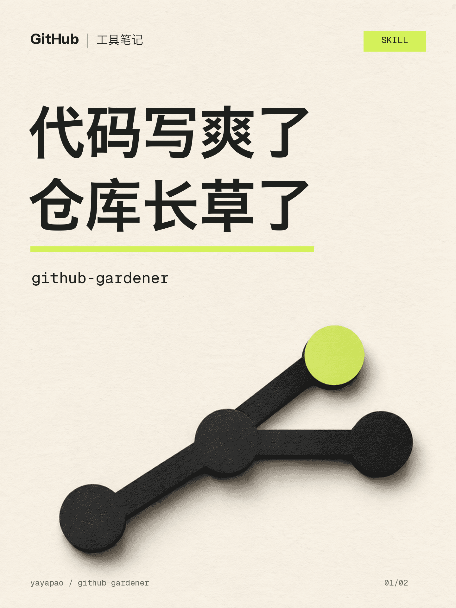
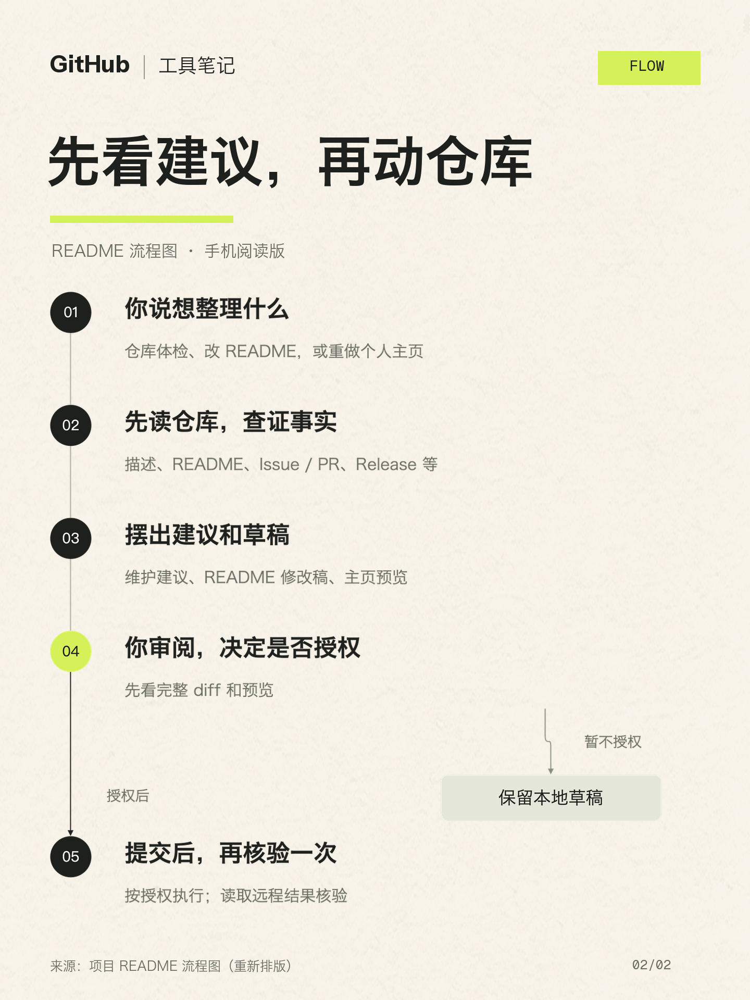

# 分享素材

本目录保存 Github Gardener 的中文分享文案与本期配图。

## 本期图文

建议顺序：封面 → 手机流程图。可复制的正文见 [中文分享文案](note.zh-CN.md)。

| 封面 | 手机流程图 |
| --- | --- |
|  |  |

两张图均为 1440 × 1920，比例 3:4。流程页依据 [README 使用的完整流程图](../assets/gardener-workflow.png) 改排，保留只读查证、草稿审阅、授权后提交与核验，以及未授权时保留本地草稿的分支。流程内容的可编辑源文件沿用 [Excalidraw 原稿](../assets/gardener-workflow.excalidraw)。

## 来源与内容口径

封面底图由 AI 辅助生成，中文和项目名在后期排版。图片是介绍素材，不是工具运行截图或实测结果。

分享文案的功能说明依据本项目的 [Skill 入口](../../SKILL.md)、[README](../../README.md) 和 [Agent 执行指引](../usage.md)。未加入作者实测经历、提效比例、排行榜或 Star 数。再次发布前应对照当前实现复核功能描述。

本目录随项目采用 [MIT 许可证](../../LICENSE)。
