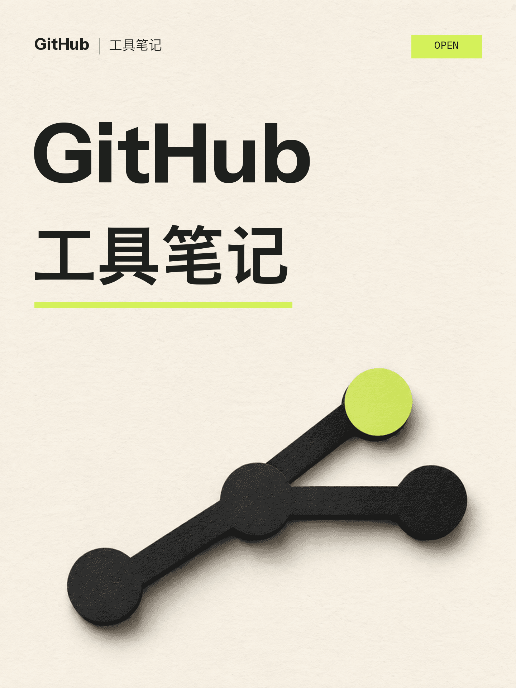

# 分享素材

本目录保存 Github Gardener 的中文分享文案、本期配图，以及后续介绍其他 GitHub 工具时可复用的封面素材。

## 本期图文

建议顺序：封面 → 手机流程图。可复制的正文见 [中文分享文案](note.zh-CN.md)。

| 封面 | 手机流程图 |
| --- | --- |
|  |  |

两张图均为 1440 × 1920，比例 3:4。流程页依据 [README 使用的完整流程图](../assets/gardener-workflow.png) 改排，保留只读查证、草稿审阅、授权后提交与核验，以及未授权时保留本地草稿的分支。流程内容的可编辑源文件沿用 [Excalidraw 原稿](../assets/gardener-workflow.excalidraw)。

## 可复用封面

| 文件 | 用途 |
| --- | --- |
| [系列通用首页](assets/github-series-intro.png) | 可直接用于 GitHub 工具笔记系列，标题为「GitHub 工具笔记」 |
| [封面底板](assets/github-cover-base.png) | 保留系列标识，留空本期标题、项目名与页脚 |
| [无字底图](assets/github-cover-background.png) | 重新设计版式时使用 |

三张素材均为 1440 × 1920。下一篇可在底板上叠加标题与项目名；本期封面和通用首页按需要择一使用。

排版参数以 1440 × 1920 画布为准：

- 安全边距：96 px；文字色 `#1E201D`，强调色 `#D4F15A`。
- 两行标题：首行约 `(89, 333)`，第二行约 `(89, 560)`，字号 180 px，建议每行约 5 个中文字符；较长标题先精简，必要时缩到 150–165 px。
- 标题下横线：约 `(96, 778)`，高 16 px，长度随标题调整。
- 项目名：约 `(99, 860)`，字号 48 px；页脚仓库路径约 `(96, 1830)`，字号 25 px。
- 本期中文使用冬青黑体简体中文 W6，项目名使用 Geist Mono。字体文件不随素材分发，可替换为可用的中文黑体与等宽字体，并重新检查换行和边距。
- 右上角标签可按工具类型在 OPEN、SKILL、CLI 等短词之间替换。

## 来源与内容口径

封面底图由 AI 辅助生成，中文和项目名在后期排版。图片是介绍素材，不是工具运行截图或实测结果。

分享文案的功能说明依据本项目的 [Skill 入口](../../SKILL.md)、[README](../../README.md) 和 [Agent 执行指引](../usage.md)。未加入作者实测经历、提效比例、排行榜或 Star 数。再次发布前应对照当前实现复核功能描述。

本目录随项目采用 [MIT 许可证](../../LICENSE)；复用通用底图时请替换具体项目名称与链接，避免造成项目归属混淆。
